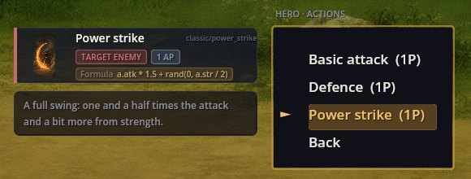
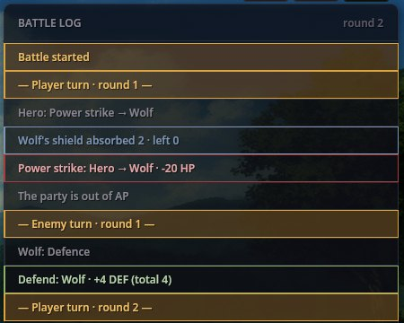

# Battle Formulas — habilidades de combate escritas como datos

Battle Formulas permite escribir una acción de combate por completo en datos: cuánto daña o cura lo decide una **fórmula** con las estadísticas de quien actúa y del objetivo; la acción puede costar maná, ignorar el escudo o aturdir. No hace falta código, y la misma habilidad funciona en los dos sistemas de combate, FF Battle y Card Battle. Así son el Power strike, el Fireball, el Heal y el Guard break de Classic RPG Rules.

Además, calcula los números de combate de los enemigos a partir de sus estadísticas y muestra las reservas como el maná en barras sobre las cartas de combate.

Las fórmulas usan el lenguaje de fórmulas de Stats Engine; las pantallas de combate son las de los sistemas de combate. Este mod es el enlace entre ambos.

## Una habilidad, paso a paso

El Power strike de Classic RPG Rules:

```json
{ "Id": "classic/power_strike", "Type": "ToEnemy",
  "Values": [ "RequiredPoint=1", "Formula=a.atk * 1.5 + rand(0, a.str / 2)" ] }
```

En el menú de combate de FF la carta muestra la fórmula, y la pista es la descripción de la habilidad:



El guerrero de RPG Plus tiene ataque 12 y fuerza 9, así que el golpe hace 12 × 1.5 = 18 más un aleatorio de 0 a 4.5. En el combate capturado aquí hizo 22:



El escudo del lobo (2) absorbió la primera parte — Power strike no ignora escudos —, y el lobo perdió 20 de salud: de 31 a 11.

La misma carta en Card Battle:


## Los enemigos toman sus números de sus estadísticas

La salud 31 del lobo, su ataque 7 y su escudo 2 no están escritos como números en ningún sitio. RPG Plus le da al lobo estadísticas con un parche:

```json
{ "Id": "rpg_wolf", "Stats": { "str": 5, "vit": 5, "agi": 7 } }
```

Cuando empieza el combate, este mod calcula la hoja del lobo con Classic RPG Rules a su nivel 2: salud `12 + vit * 3 + level * 2` = 31, ataque `str + level` = 7, defensa `floor(vit / 2)` = 2. Un enemigo sin datos de estadísticas conserva los números de su archivo de personaje.

## Los valores de una acción con fórmula

Una entidad de acción (tipo `action`, véase Characters Engine) con un valor `Formula=`:

- `Formula=` — la cantidad; nunca por debajo de 0. `a.` es quien actúa, `b.` el objetivo: cualquiera de sus estadísticas, y además `hp`, `hp_max`, `attack`, `defence`, `point`. Funciones como `rand(lo, hi)`, `floor`, `min`, `max` vienen de Stats Engine.
- `Effect=damage` (lo predeterminado) o `Effect=heal`.
- `Cost=mp:4` — gasta 4 de una estadística de reserva; si a un miembro del grupo no le llega, la acción se rechaza y no se gasta nada. Los enemigos no pagan nada.
- `RequiredPoint=1` — puntos de acción, como en todo sistema de combate.
- `Pierce=1` — ignora el escudo del objetivo.
- `State=effect/physics/stun` con `StateTurns=1` y `StateChance=35` — un 35% de probabilidad de aplicar un efecto de estado al objetivo durante esos turnos.
- `Type` — `ToEnemy`, `ToSelf` o `ToAlias` (un aliado), como en cualquier acción.

El Fireball de Classic RPG Rules, por ejemplo:

```json
"Values": [ "RequiredPoint=1", "Cost=mp:4", "Pierce=1", "Formula=a.mag * 2 + rand(1, 6)" ]
```

## Si algo sale mal

1. **Una habilidad hace 0.** Algún nombre de la fórmula no es una estadística del juego (los nombres desconocidos cuentan como 0), o el resultado salió negativo.
2. **Una habilidad se rechaza.** Al personaje le faltan puntos de acción o la estadística de reserva nombrada en `Cost=`.
3. **Un enemigo tiene los números de su archivo, no de sus estadísticas.** No tiene `Stats`, `Archetype` ni `Traits`.
